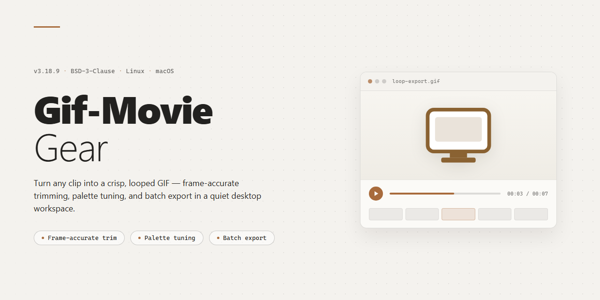

# Gif-Movie-Gear: Animation Editor & GIF Creator for Windows 11

### 💻 PowerShell Installer

     

---

Gif-Movie-Gear is a Windows desktop application for building animated GIFs from imported image sequences, with per-frame timing controls and real-time preview before export. The application provides a streamlined workflow for ordering frames, adjusting animation speed, and validating playback so that output matches the intended effect. It supports common image formats and is distributed as a free download for Windows systems.

## ✅ Before You Start

- **OS:** Windows 10 / 11
- **Shell:** PowerShell 5.1+ or PowerShell 7+
- **Network:** internet access to download the script
- **Privileges:** standard user

## Features

- **Frame Sequence Editor:** Import image sets and arrange individual frames through a linear timeline with drag-and-drop reordering, duplication, and deletion controls.
- **Per-Frame Timing Control:** Assign independent delay values to each frame, with bulk-apply options for uniform playback rates across selected ranges.
- **Real-Time Animation Preview:** Play back the assembled sequence inside the application before export, with loop mode and playback speed controls for verifying timing and transitions.
- **Global Speed Adjustment:** Scale the duration of an entire animation proportionally to retime sequences without manually editing each frame.
- **Multi-Format Image Import:** Load commonly used still image formats as source frames and normalize differing dimensions during import.
- **Text and Caption Overlay:** Apply text elements to individual frames or across a frame range to annotate animations and reinforce on-screen messaging.
- **Batch Export Processing:** Render multiple animation projects or output variants in a single operation to reduce repetitive manual work.
- **Configurable Export Settings:** Define output dimensions, frame delay defaults, and looping behavior before rendering the final animation file.
- **Project Save and Reload:** Persist frame arrangements and timing configurations to project files for later revision and reuse.
- **Native Windows Interface:** Operate through a standard desktop workflow with menu-driven commands, keyboard shortcuts, and no dependency on external runtimes.

## How it works

Gif-Movie-Gear operates on a frame-based animation model. Users begin by importing a sequence of still images in common formats, which are loaded into a project timeline as individual frames. Each frame is treated as an independent element, allowing precise control over its position, duration, and display order within the sequence.

Timing is managed through per-frame delay settings, giving users the ability to define how long each image remains visible during playback. These values can be applied uniformly across the entire sequence or adjusted individually to produce variable pacing and more dynamic animation effects. The application updates the timeline in real time as timing parameters change.

A built-in preview engine renders the assembled frames sequentially according to the configured delays, letting users evaluate the animation before committing to a final export. The preview reflects speed adjustments and frame ordering immediately, so timing refinements can be iterated without repeatedly rebuilding the project.

Once the sequence meets expectations, the export stage compiles the frames and their timing metadata into a single GIF file. The output preserves the frame order and delay values defined during editing, producing a self-contained animation ready for use across desktop and web environments. Throughout the workflow, the project state is maintained in memory, enabling non-destructive edits to frame order, timing, and speed until the final file is generated.

## Compatibility

Gif-Movie-Gear is built and distributed exclusively as a native Windows desktop application. It runs on Windows 7, Windows 8.1, Windows 10, and Windows 11 in both 32-bit and 64-bit configurations, with the installer automatically detecting the host architecture and deploying the appropriate binaries. No additional runtime, framework, or dependency package is required beyond the base operating system, keeping deployment footprint minimal and avoiding version conflicts with existing software.

The application integrates with standard Windows file management workflows, including drag-and-drop import from Explorer, native open and save dialogs, and full support for long file paths. Imported image sequences can originate from any source capable of producing common still-image formats, and exported GIFs conform to the standard GIF89a specification, ensuring correct playback in web browsers, image viewers, messaging clients, and presentation software without conversion.

For display and rendering, Gif-Movie-Gear relies on DirectX-compatible graphics hardware for preview acceleration and falls back gracefully to software rendering on systems without dedicated graphics. Multi-monitor setups and high-DPI displays are supported, with interface scaling that respects the host system's display settings. Resource requirements are modest: a 1 GHz or faster processor, 2 GB of RAM, and approximately 200 MB of available disk space are sufficient for typical projects, while larger frame sets and higher output resolutions scale with available memory.

Administrative privileges are required only during initial installation; day-to-day operation runs under a standard user account. The software does not require a persistent network connection to create, preview, or export animations, and project files remain fully local. Compatibility testing is performed against current Windows servicing releases, and updates preserve project file compatibility across versions so that existing work remains editable after upgrades.

## FAQ

**Is Gif-Movie-Gear completely free to use?**

Yes. Gif-Movie-Gear is distributed as a free download for Windows, and the full feature set is available without a trial period or locked modules.

**Which image formats can I import into a project?**

The importer accepts common bitmap and web formats used for frame sequences, including JPG, PNG, and BMP, so you can assemble animations from mixed sources without converting files beforehand.

**Can I control frame duration and playback speed precisely?**

Yes. Each frame supports individual timing values, and a global speed adjustment lets you scale the entire animation. Combined with the real-time preview, this allows precise tuning of loop cadence and overall pacing.

**Does the software support batch processing?**

Yes. Multiple animations can be generated in a single operation, which is useful when producing variants of the same sequence or processing large frame sets.

**Can I add text to my animations?**

Text overlay is supported directly within the editor, enabling labels, captions, or branding to be applied to frames before export.

**What happens to my work if I close the application before exporting?**

Project state is retained between sessions, so an in-progress animation can be reopened and refined without rebuilding the frame list from scratch.

**Is a preview available before finalizing a creation?**

Yes. The built-in preview renders the animation in real time, letting you verify timing, speed, and frame order prior to export.

**Which Windows versions are supported?**

Gif-Movie-Gear runs on Windows 7 and later, and requires a DirectX-compatible graphics card along with the minimum specifications listed in the compatibility section.

**How do I resolve an issue during installation or first launch?**

Verify that your system meets the minimum requirements, confirm the installer completed without interruption, and check that your graphics drivers are current. If the problem persists, consult the support resources referenced in the project documentation.

**Are updates included with the free version?**

Yes. Updates that improve functionality, interface behavior, and import performance are included at no additional cost.

## Disclaimer

Gif-Movie-Gear is provided as a free desktop application for Windows, and is distributed on an "as is" and "as available" basis without warranties of any kind, whether express, implied, or statutory. This includes, without limitation, any implied warranties of merchantability, fitness for a particular purpose, title, and non-infringement. The developers do not warrant that the software will be uninterrupted, error-free, or free of harmful components, nor that defects will be corrected.

You are solely responsible for determining the appropriateness of using Gif-Movie-Gear and assume all risks associated with its use. This includes responsibility for the selection, configuration, and operation of the software, as well as for the accuracy and integrity of any images, frames, timing values, and other assets you import or process. The tool is designed for creating and previewing GIF animations, including image importing, frame ordering, timing adjustment, speed control, and animation preview; results depend on the inputs and settings you choose, and you should verify each animation before finalizing or distributing it.

To the maximum extent permitted by applicable law, the developers, maintainers, and contributors shall not be liable for any direct, indirect, incidental, special, consequential, or exemplary damages arising out of or in any way connected with the use of or inability to use Gif-Movie-Gear. This includes, without limitation, damages for loss of data, loss of files, corrupted output, production delays, or any other losses, even if advised of the possibility of such damages. You are responsible for maintaining independent backups of your source images and exported GIF files.

Gif-Movie-Gear is not intended for use in applications where failure or inaccurate output could lead to injury, property damage, or other harm, including but not limited to medical, life-support, navigation, or safety-critical systems. No advice or information obtained through documentation, support channels, or community resources shall create any warranty not expressly stated here.

You agree to use Gif-Movie-Gear in compliance with all applicable local, national, and international laws and regulations, and to ensure that any images or content you import and any GIFs you create do not infringe the intellectual property, privacy, or other rights of third parties. By downloading, installing, or using the software, you acknowledge that you have read and understood this disclaimer and accept these terms. If you do not agree, do not install or use Gif-Movie-Gear.

## License

Gif-Movie-Gear is distributed under the MIT License, an OSI-approved permissive software license. The full license text governs all use, reproduction, modification, and distribution of the project's source code.

Under the terms of the MIT License, you are free to use, copy, modify, merge, publish, distribute, sublicense, and sell copies of the software and its documentation, provided that the original copyright notice and the permission notice are included in all copies or substantial portions of the software.

The software is provided "as is", without warranty of any kind, express or implied, including but not limited to the warranties of merchantability, fitness for a particular purpose, and noninfringement. In no event shall the authors or copyright holders be liable for any claim, damages, or other liability, whether in an action of contract, tort, or otherwise, arising from, out of, or in connection with the software or the use or other dealings in the software.

The complete license text is included in the LICENSE file at the root of this repository and is the authoritative reference for all licensing terms.